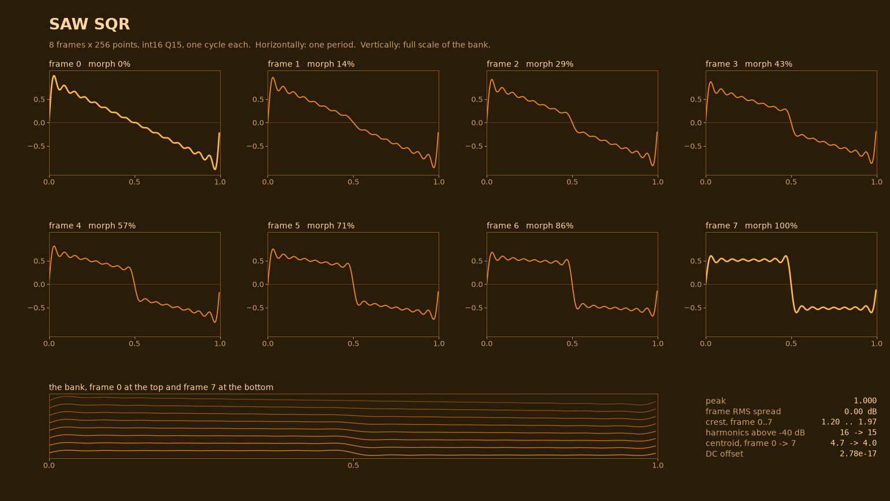
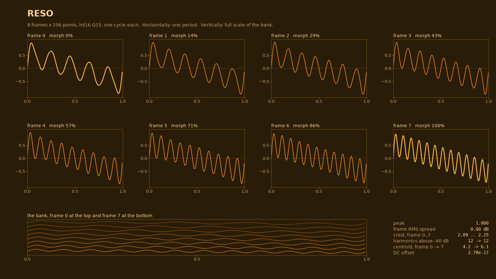
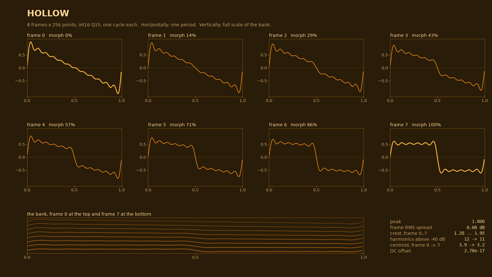
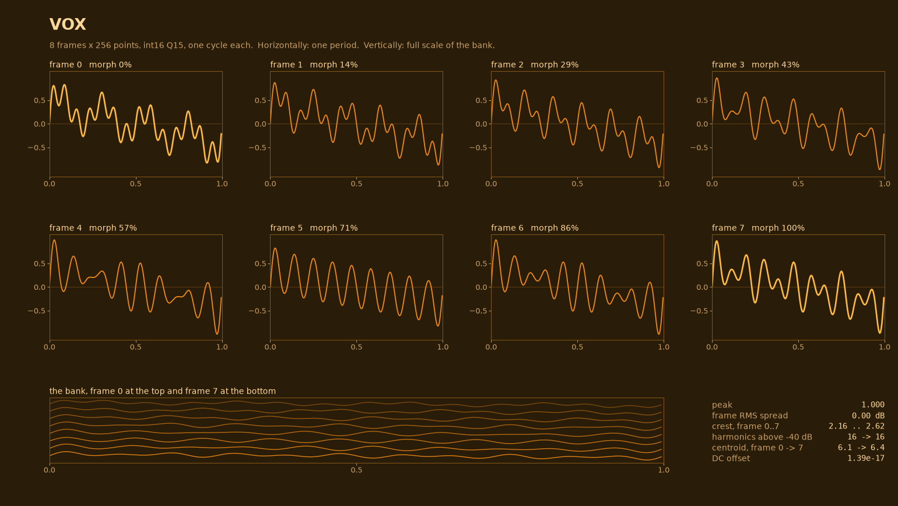
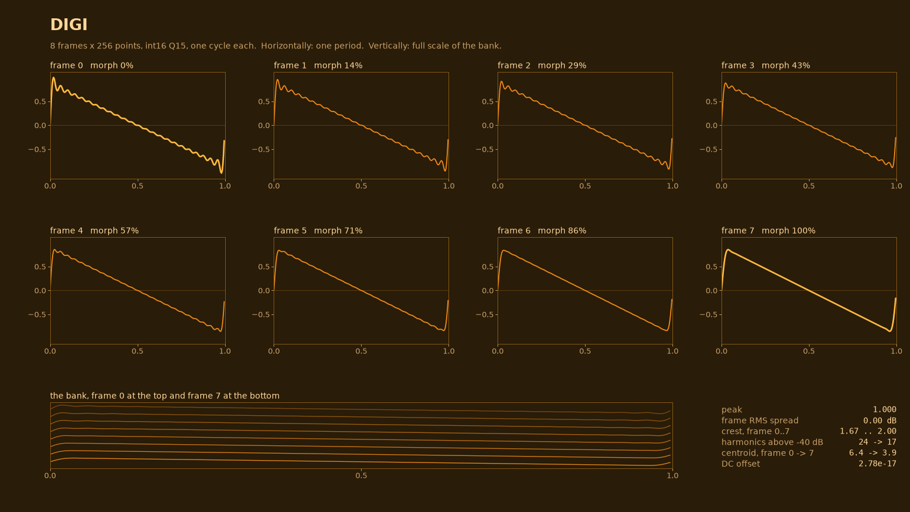
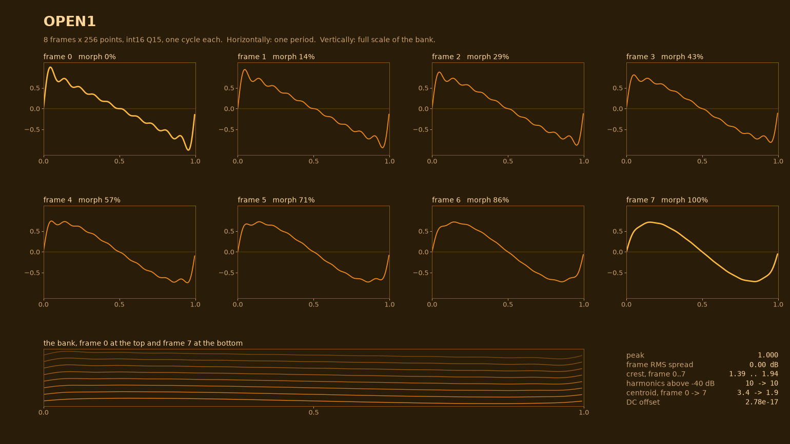
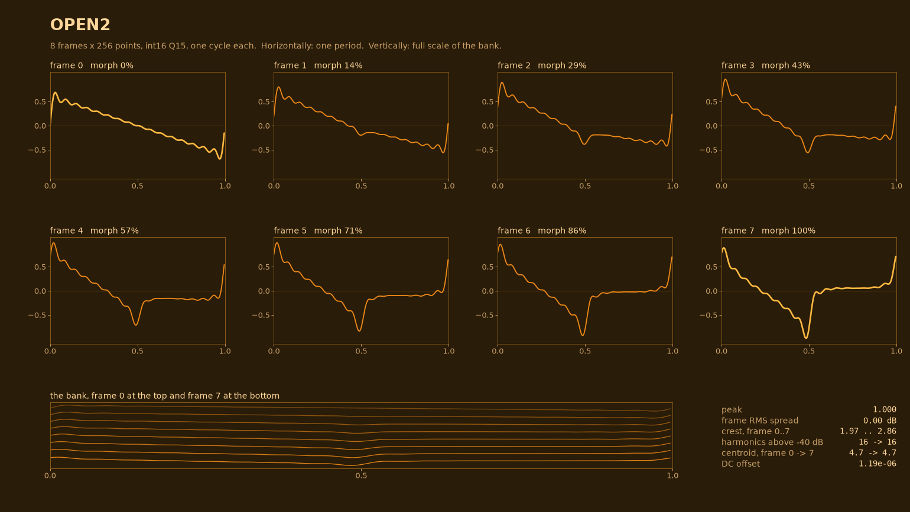
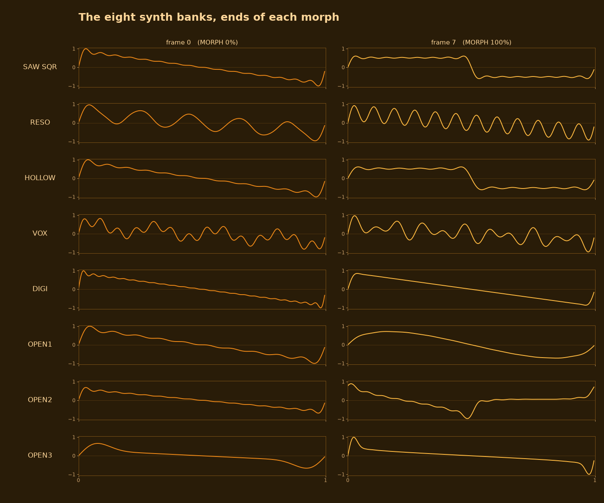

# The synth banks, frame by frame

<!-- SPDX-License-Identifier: MPL-2.0 -->

All eight banks are generated by `app/tools/gen_wv_banks.py` at build time — there is
no hand-drawn data in the repository and no sample material behind them. The script's
`BANKS` table is a list of `(harmonic, amplitude, phase)` triples per frame, an inverse
FFT by hand, so **every bank is defined by its spectrum, not by its picture.**

This document is generated from the same script. The pictures come from
`app/tools/gen_wv_figures.py`, which imports `BANKS` and draws the arrays the firmware
is built from; the numbers under each heading are computed from those same arrays. If a
frame in the generator is wrong, the picture here is wrong in the same way — which is
the point.

```
python3 app/tools/gen_wv_figures.py         # rewrite docs/img/wv-*.png
python3 app/tools/gen_wv_figures.py --check # print the numbers, draw nothing new
```

---

## What every bank shares

| property | value | why |
|---|---|---|
| points per cycle | **256** | one cycle, read with linear interpolation (`wv_table_read`, `wv_dsp.h`) |
| frames per bank | **8** | MORPH 0..127 maps to frames 0..7 with a crossfade between neighbours |
| sample format | **int16, Q15** | `32767` = full scale |
| size | **4 KiB per bank**, 8 banks = 32 KiB | in flash, read in place (XIP) — never copied to RAM |
| mixing across frames | **shared partials** | frame *f* and *f+1* differ in the *amplitude* of the same harmonics, never in *which* harmonics exist, so MORPH sweeps instead of snapping |
| normalisation | **one scale per bank** | see below |
| MORPH | crossfade of two neighbours | `mf = morph*7/127`, `m0 = int(mf)`, `m1 = min(m0+1, 7)` |

### The normalisation, because it is what makes MORPH usable

`norm_bank()` does two things in a fixed order, and the order is the design:

1. **Equalise every frame's RMS.** Without this MORPH is a volume knob. Measured: with
   peak normalisation alone, OPEN3's frames swing **3.2 dB** from frame 0 to frame 7
   (−0.8, −1.4, −1.8, −2.3, −2.6, −2.9, −3.2 dB), because a formant climbing the
   harmonic series gets spikier (crest 2.14 → 3.21) at an identical partial count. Frames
   whose spectrum is nearly empty are left alone rather than amplified into noise.
2. **Then scale the whole bank by one factor** so its loudest point is full scale, so
   int16 can never clip.

Measured across all eight banks: **frame RMS spread = 0.00 dB**, i.e. step 1 holds
exactly. Peak-normalising the bank alone would satisfy step 2 and leave step 1 broken —
that was the bug this replaced.

**Consequence, deliberately kept:** banks are *not* equal in loudness, because their
crest factors differ. Measured with one key at one master setting:

| bank | level vs the loudest |
|---|---|
| OPEN1 | +0.00 dB |
| HOLLOW | −0.08 dB |
| SAW SQR | −0.14 dB |
| DIGI | −0.26 dB |
| RESO | −1.32 dB |
| VOX | −2.61 dB |
| OPEN2 | −3.38 dB |
| OPEN3 | −4.40 dB |

A **4.40 dB spread** across the eight. Equalising it would need a per-bank trim in the
voice's gain — a table of eight numbers — and has not been done. Turning the BANK knob
therefore does change how loud the instrument is, beyond what the timbre itself does.

### Aliasing: not a problem on this keybed

Linear interpolation removes staircase error, not harmonics that were above Nyquist
when the table was built — so the question is whether any bank's top partial crosses
22.05 kHz (half of **44.1 kHz**, `WAVE_HZ` in `app.c`).

**None of them do, anywhere on the instrument.** Measured at the highest key,
G5 = 440.0 Hz, with each frame's highest partial above −40 dB:

| bank | worst partial count | that partial at G5 | |
|---|---|---|---|
| OPEN1 | 10 | 4,400 Hz | |
| RESO, HOLLOW | 12 | 5,280 Hz | |
| SAW SQR, VOX, OPEN2 | 16 | 7,040 Hz | |
| DIGI | 24 | 10,560 Hz | |
| OPEN3 | 23 | 10,120 Hz | |

The worst case in the whole instrument is DIGI at 10,560 Hz — **10.5 kHz of headroom**
below Nyquist. The keybed is F3..G5 (`NKEYS 27`, `plat.h`), 27 keys, not a full piano,
and that is what makes the table size work.

So the note in `spec.md` §5a about accepted aliasing is about the design's headroom
rather than a defect you can hear today: it starts to matter when a bank is added with
more partials, or if the keybed is ever extended upward. Band-limited mip-maps (4× the
flash plus an index per voice) remain the fix if that day comes.

---

## The eight banks

### 0 · SAW SQR — sawtooth to square

`morph(saw(16), square(16))` — all 16 partials at `1/k` at frame 0, odd partials only at
frame 7. The classic rich sweep: every even harmonic fades out linearly.



- **crest 1.20 → 1.97** — the square's spikier peak for the same RMS
- **harmonics above −40 dB: 16 → 15** (the 16th leaves last)
- **centroid 4.7 → 4.0** — darker as the evens go, which is the opposite direction of
  what "brighter square" intuition suggests: removing energy *above* the fundamental
  is not what happens here, removing the even ones lowers the centre of mass

### 1 · RESO — a resonance walking up the harmonics

`walk(lambda f: saw(12) + [(5+f, 1.2, 0)])` — a 12-partial saw with one extra partial at
amplitude 1.2, whose index climbs 5 → 12 as MORPH advances. A filter sweep approximated
in the spectrum instead of by filtering, which is why it is smooth and why it cannot be
modulated by the CUT knob.



- **crest 2.09 → 2.25** — nearly constant, because the bump never leaves the 12-partial
  bed; this is the most "even" bank in the set
- **centroid 4.2 → 6.1** — the largest upward move of any morph here, which is exactly
  what a resonance sweep should do
- **the bump's amplitude is 1.2 against a 1/k bed**, so it dominates near the
  fundamental and is modest near harmonic 12

### 2 · HOLLOW — saw to odd-only, with the phase rotated

`morph(saw(12), odd-only at π/2)`. The same partial-amplitude change as SAW SQR on the
inside, but the target is generated with **phase π/2 on every partial**, so the endpoint
is not a square but a pulse-like cycle. Frame 7 is *not* the same waveform as SAW SQR's
frame 7, despite the same harmonic list — this is the one place where phase matters.



- **crest 1.20 → 1.95**
- **harmonics above −40 dB: 12 → 11**
- called "clarinet → square-ish" in the generator; the odd-only spectrum *is* the
  clarinet, the rotated phase is what keeps it from being a square

### 3 · VOX — two formants moving in opposite directions

`walk(lambda f: saw(16) + [(4+f, 1.1, 0), (14-f, 0.9, 0)])` — a 16-partial saw with two
bumps: one climbs 4 → 11, one descends 14 → 7. They cross at frame 5, both landing on
h9, then swap sides.

**Both bumps move (+1, −1) on every frame — that is the point of this version.** The WT
original reached for the same sound with `4 + (f % 6)` / `11 − (f % 5)`, and the modulo
wraps. Read off the parameters frame by frame:

| frame | 0 | 1 | 2 | 3 | 4 | 5 | 6 | 7 |
|---|---|---|---|---|---|---|---|---|
| WT, climbing bump | 4 | 5 | 6 | 7 | 8 | 9 | **4** | 5 |
| step | | +1 | +1 | +1 | +1 | +1 | **−5** | +1 |
| WT, descending bump | 11 | 10 | 9 | 8 | 7 | **11** | 10 | 9 |
| step | | −1 | −1 | −1 | −1 | **+4** | −1 | −1 |

The two bumps pass through each other at frame 4 — and then **wrap, at different
frames**: the descending bump jumps back to h11 at frame 5 (`f % 5` reset), the climbing
bump jumps back to h4 at frame 6 (`f % 6` reset). Frames 5–7 therefore replay positions
the sweep already visited (h11, then h4, then h5) instead of continuing past the
crossing. This version drops both modulos and widens the span to `4 + f` / `14 − f`, so
the step is (+1, −1) on all eight frames and frame 5 is a crossing rather than a reset.

**A note on how not to test this:** adjacent-frame spectral correlation does *not* show
the break. Measured, WT's VOX correlates 0.54–0.90 between neighbours and this version
0.28–0.39 — the fixed version scores *lower*, because a wider formant sweep moves the
spectrum further per frame. The parameter table above is the evidence; the correlation
number would have argued for the wrong version.



- **crest 2.16 → 2.62** — the second spikiest bank, because two narrow bumps on a 1/k
  bed concentrate energy
- **centroid 6.1 → 6.4** — nearly flat overall, but that flatness is the two bumps
  cancelling: they move a lot and swap places
- **also the second quietest bank at −2.61 dB**, for the same reason

### 4 · DIGI — a bright edge that softens

`morph(saw(24), [(k, (1/k)·(0.5+0.5·cos(πk/24)), 0)])` — 24 partials at `1/k`, ending as
the same ramp windowed by a raised cosine that reaches zero at harmonic 24.

**The endpoint is the whole point of this bank, and the earlier version got it wrong.**
WT's DIGI morphed to an odd-only `1/k²` series, which its own comment called "a rounded
pulse". Measured, that endpoint is h1 = 1.000, h3 = 0.111, h5 = 0.040 — **4** partials
above 2 % of the fundamental, crest **1.28**, i.e. *flatter than a sine* (1.414). It was
not a soft pulse, it was nearly a sine, and the last two frames of that bank all but
disappeared. The raised cosine here leaves **15** partials and crest **1.70**: still a
pulse, still an edge, just a duller one — which is what "a bright edge that softens"
has to mean.



- **crest 1.67 → 2.00**
- **harmonics above −40 dB: 24 → 17** — the largest drop of any bank here; the raised
  cosine removes the top of the series
- **centroid 6.4 → 3.9** — the brightest frame 0 of any bank (6.4) and the largest
  downward move (2.5 harmonics), so this is the bank that sweeps *dark*
- 24 partials is the most any bank starts with, so of the eight this is the one that
  would reach Nyquist first if the keybed were extended — at G5 its 24th partial sits at
  10,560 Hz, and 22,050 Hz is where it would fold

### 5 · OPEN1 — saw to a `1/k²` series (a placeholder that is a real bank)

`morph(saw(10), [(k, 1/k², 0)])` — the same 10 harmonics, reweighted from `1/k` to
`1/k²`. A fast, smooth darkening with no formant and no phase movement.



- **crest 1.39 → 1.94**
- **centroid 3.4 → 1.9** — the lowest centroid of any bank at frame 7: almost a sine
  with a little second and third
- **the loudest bank in the set** (+0.00 dB), because a near-sine has crest ≈ √2
- marked in the generator as one of three placeholders ("real banks, not dead slots, so
  the instrument has eight playable timbres while the last three are decided")

### 6 · OPEN2 — phase rotation, amplitude unchanged

`walk(lambda f: [(k, 1/k, (f/4) if k even else 0)])` — 16 partials at `1/k` with the
**even** partials' phase rotated by `f/4` radians per frame, up to 1.75 rad at frame 7.



- **centroid 4.7 → 4.7** — unchanged to one decimal, because *phase does not change the
  magnitude spectrum at all*
- **crest 1.97 → 2.86** — but it changes the waveform and therefore the peak: same
  spectrum, spikier cycle
- this is the clearest demonstration in the set that "same harmonics" and "same sound"
  are different claims: the magnitude spectrum is identical frame to frame, and the
  waveform is not
- whether you *hear* a difference depends on the voice's start phase, which this
  firmware fixes per voice slot (`pick * 1/3` of a cycle, `wv_note`, so two voices of
  one note do not sum to a 6 dB peak on sample 0) rather than randomising. With a fixed
  start phase a phase-rotated cycle really is a different waveform in the ear; with a
  randomised one it would average out
- **−3.38 dB**, the second quietest, because the crest rise costs level for a fixed peak

### 7 · OPEN3 — a constant-Q formant climbing the series

`walk(lambda f: [(k, (1/k)·exp(−(k−(3+f))²/(2·(0.35·(3+f))²)), 0)])` — a Gaussian bump
whose centre climbs 3 → 10 and whose **width scales with the centre** (constant Q).


- **centroid 2.5 → 6.9** — the lowest starting point and the highest ending point of any
  bank: the widest sweep here
- **harmonics above −40 dB: 7 → 23** — the band widens by 16 partials, the largest
  increase
- **crest 2.14 → 3.21** — the spikiest frame in the whole set, which is why it is
  **the quietest bank (−4.40 dB)**
- the constant-Q width is not cosmetic: without it the frame gets spikier as the bump
  climbs, and the MORPH volume swing that prompted the RMS equalisation (3.2 dB, see
  above) was measured on exactly this bank

---

## The eight together

Ends of each morph only — frame 0 on the left, frame 7 on the right.



---

## What was not true about these banks

`gen_wv_banks.py` used to say the first five "are reproduced here so the two instruments
can be compared". The word was wrong, but the direction of the mistake matters: these
are not copies, they are **fm1-wave's revision of WT's five**, by the same author.
Compared against WT's `gen_wt_tables.py` (Melodee PR #48, MPL-2.0), partial by partial
and frame by frame:

| bank | spectra identical? | what differs, and which version is the fix |
|---|---|---|
| SAW SQR | **yes** (`|ΔA|/A = 0.000`, per-frame normalised) | only the levelling: WT peak-normalises the bank, this one equalises frame RMS first, then peak-normalises. The revision is the RMS step — peak normalisation alone makes MORPH a volume knob (3.2 dB across OPEN3, see above) |
| RESO | **yes** (`0.000`) | same |
| HOLLOW | **yes** (`0.000`) | same |
| VOX | **no** — up to **1.100** | WT moves the second bump `11 − (f % 5)` and the first `4 + (f % 6)`; the modulo **wraps**. Measured, bump positions frame 5→6: `(9,11) → (4,10)`, a step of **(−5,−1)** where every other frame moves (+1,−1). The sweep breaks there. This version's `4 + f` / `14 − f` steps (+1,−1) for all eight frames. **WT's VOX is the bug; this is the fix** |
| DIGI | **no** — up to **0.494** at harmonic 2, frame 7 | WT's endpoint is a `1/k²` odd-only series, which its own comment calls a "rounded pulse". It is not one: measured, h1 = 1.000, h3 = 0.111, h5 = 0.040, **4** partials above 2 % of the fundamental, crest **1.28** — flatter than a sine (1.414). It ends as a near-sine. This version's `1/k` × raised cosine ends at crest **1.70** with **15** partials, which is the "bright edge softening" the bank is named for |

So three banks are the same sound at different levels, and two are corrections of the
earlier version under the same names. **A bank-for-bank comparison of the two
instruments would find the same names, three identical timbres, and two where fm1-wave
is right and WT is wrong** — anyone porting VOX or DIGI back from WT would be porting the
bug and the mislabel.

`gen_wv_banks.py`'s comment has been corrected to say this.

---

## Where the other five came from, and what is still open

- Banks 0–4 are **fm1-wave's revision of WT's five**, by the same author: same names and
  same sweep intent, with VOX's wraparound fixed, DIGI redefined to actually be a
  softening pulse, and the levelling changed to per-frame RMS equalisation. Three of the
  five are otherwise the same sound.
- Banks 5–7 are OPEN1..3: placeholders with their parameters fixed but their names and
  final character undecided (`spec.md` §5a says 6–8 are open).

**Measured and still unfixed:**

- **SAW SQR and HOLLOW are effectively the same bank.** Spectral correlation frame by
  frame is **0.993 .. 0.996**, and the waveforms correlate at 0.994 even at frame 7
  where HOLLOW's target partially carries π/2 phase. The two differ in harmonic count
  (16 vs 12) and in what the endpoint waveform looks like, and essentially not in what
  you hear. One of the eight banks is therefore nearly a duplicate.
- **OPEN2 and OPEN3 do not move linearly in MORPH** — their change per quarter turn of
  the knob is not 25 % of the whole sweep. This is a perceptual measure and has not been
  quantified here; it is carried over from earlier listening, and the numbers above
  (centroid 4.7 → 4.7 flat for OPEN2, 2.5 → 6.8 for OPEN3) are consistent with both
  ending up uneven for different reasons.

Both are fixable in `BANKS` and neither has been decided.

**Previously claimed and now retracted:** an earlier session recorded that "RESO and VOX
jump between frames instead of sweeping". Measured now, they are the two most *different*
banks in the set (spectral correlation 0.32 .. 0.44 between them), which is a statement
about RESO vs VOX, not about frame-to-frame stepping inside either one — and the
frame-to-frame continuity was never the thing that number could show. It should not be
carried forward as a known defect without a measurement that actually tests it.
